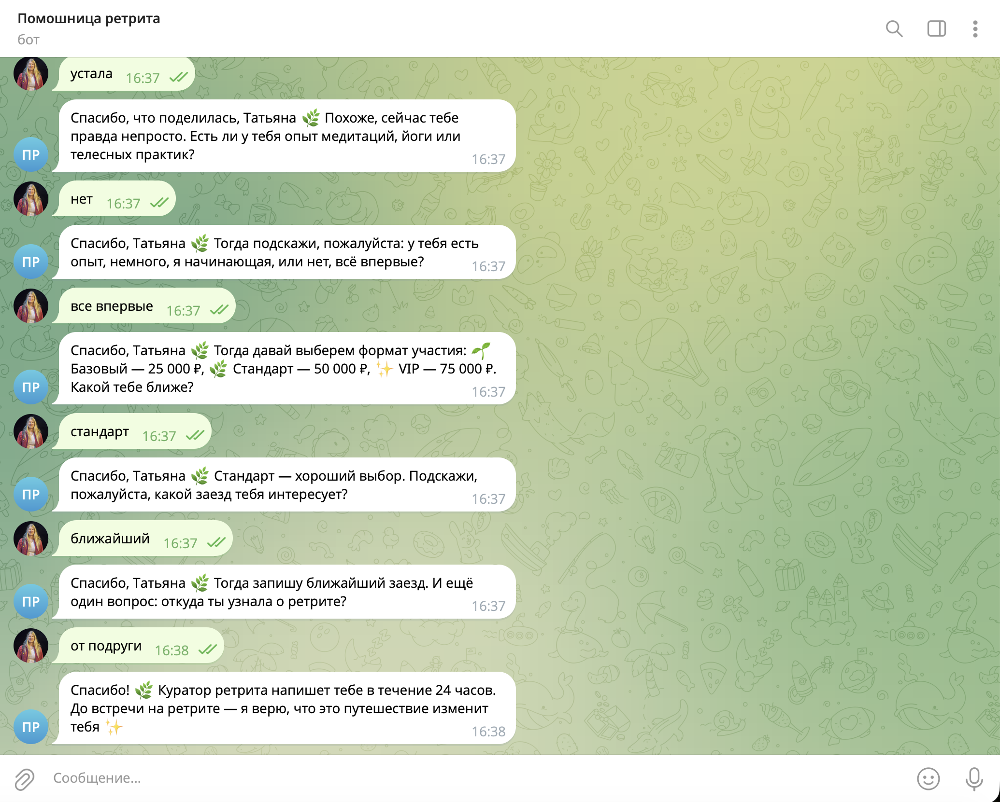

# AI-квалификатор лидов «Лея» для ретрита «Познай себя»

Telegram-бот, в котором AI-ассистент Лея живым разговором помогает потенциальной участнице записаться на женский ретрит. Бот берет на себя первый контакт менеджера: знакомится, выясняет запрос, собирает контакты и передает куратору готовую заявку.


## О проекте

Лея ведет свободный диалог, а не анкету с полями. Языковая модель сама решает, какой вопрос задать следующим, понимает ответы в любой форме и достает из них нужные данные. Когда все собрано, заявка уходит в закрытый Telegram-чат куратора, а участница получает сообщение, что с ней свяжутся в течение 24 часов.

## Задача

Менеджеры ретрит-центра тратили до 40% времени на первичные уточняющие вопросы. Клиентки терялись на длинных анкетах, им не хватало живого внимания.

Аудитория ретрита — женщины 30–40 лет, для которых важна теплая и безопасная атмосфера. Бот должен был разговаривать с эмпатией, без давления и в тоне бренда, и при этом довести человека до заявки.

## Решение

1. **Диалог вместо анкеты.** Лея по очереди выясняет имя, запрос (что привело к ретриту), опыт практик (медитации, йога, телесные практики), формат участия, интересующие даты, контакт для связи и откуда участница узнала о ретрите.
2. **Три формата участия.** Базовый за 25 000 ₽, Стандарт за 50 000 ₽ и VIP за 75 000 ₽. Модель помогает выбрать и записывает выбор в заявку.
3. **Структурированная заявка.** Ответы модели проверяются схемой Pydantic. Заявка отправляется, только когда заполнены все поля и участница готова.
4. **Устойчивость к сбоям.** Запрос к OpenAI повторяется до трех раз при временных ошибках. Если API так и не ответил, бот переключается на встроенные правила и продолжает разговор.
5. **Без своей базы.** Сессии живут в памяти бота, заявки уходят куратору сообщением. Контейнеру не нужны открытые порты, бот сам опрашивает Telegram.

## Как это выглядит

| Начало диалога | Завершение диалога | Заявка у куратора |
|:-:|:-:|:-:|
|  |  |  |

Участница нажимает «Старт», Лея здоровается и спрашивает имя. Дальше разговор идет в ее темпе. В конце куратор получает карточку: имя, запрос, выбранный формат, даты и контакт.

## Результат

- Первичная квалификация лидов автоматизирована полностью: менеджер получает готовую карточку со всей предысторией.
- Клиентка получает мгновенную теплую реакцию в любое время суток.
- Если OpenAI недоступен, запись все равно продолжается.

## Стек технологий

| Технология | Зачем используется |
|---|---|
| **Python 3.12** | Язык проекта |
| **aiogram 3** | Работа с Telegram: сообщения, команды, ответы |
| **OpenAI API** | Ведет диалог в тоне бренда и достает данные из ответов. Модель задается в `.env`, по умолчанию `gpt-4.1-mini` |
| **httpx** | Запросы к OpenAI с повтором при временных сбоях |
| **Pydantic** | Схемы заявки, сессии и ответа ассистента |
| **pydantic-settings** | Настройки из `.env` |
| **Docker Compose** | Запуск бота на сервере одной командой |

## Структура репозитория

- `bot/`: обработчики Telegram и форматирование сообщений.
- `services/assistant/`: запросы к OpenAI, промпт Леи и запасные правила.
- `services/workflow.py`: шаги разговора и отправка заявки.
- `services/telegram/operator_notifier.py`: заявка куратору.
- `services/storage/`: хранение сессий в памяти.
- `core/`: настройки, логирование, схемы данных.
- `demo/`: скриншоты.

## Запуск

Нужны Docker и Docker Compose.

```bash
cp .env.example .env
docker compose up -d --build
```

В `.env` заполните `TELEGRAM_BOT_TOKEN`, `OPERATOR_CHAT_ID` (чат куратора, куда приходят заявки) и `OPENAI_API_KEY`.

Без Docker:

```bash
pip install -r requirements.txt
python main.py
```

## Автор

Татьяна Дзюбас, AI-инженер по автоматизации. Делаю Telegram-ботов, RAG-ассистентов и LLM-агентов, которые снимают рутину с небольших команд. Кейсы и контакты на [tatidzufri.com](https://tatidzufri.com).
