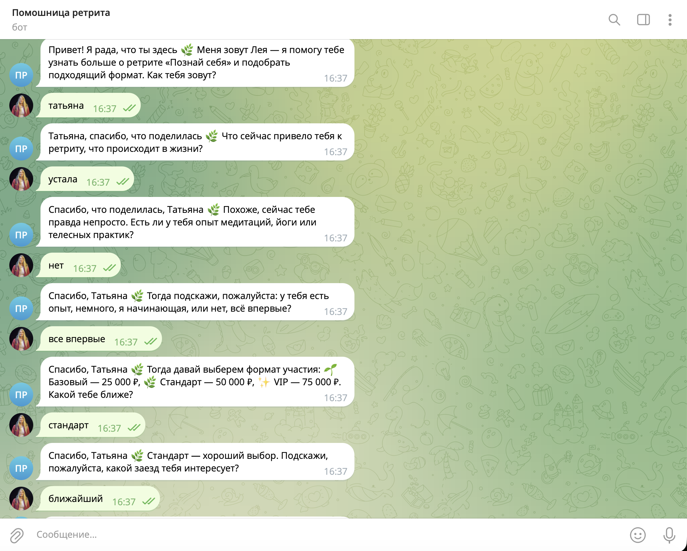
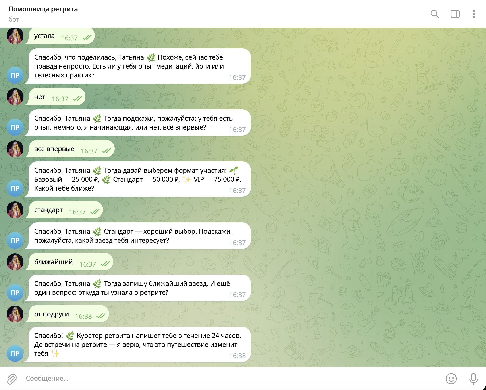
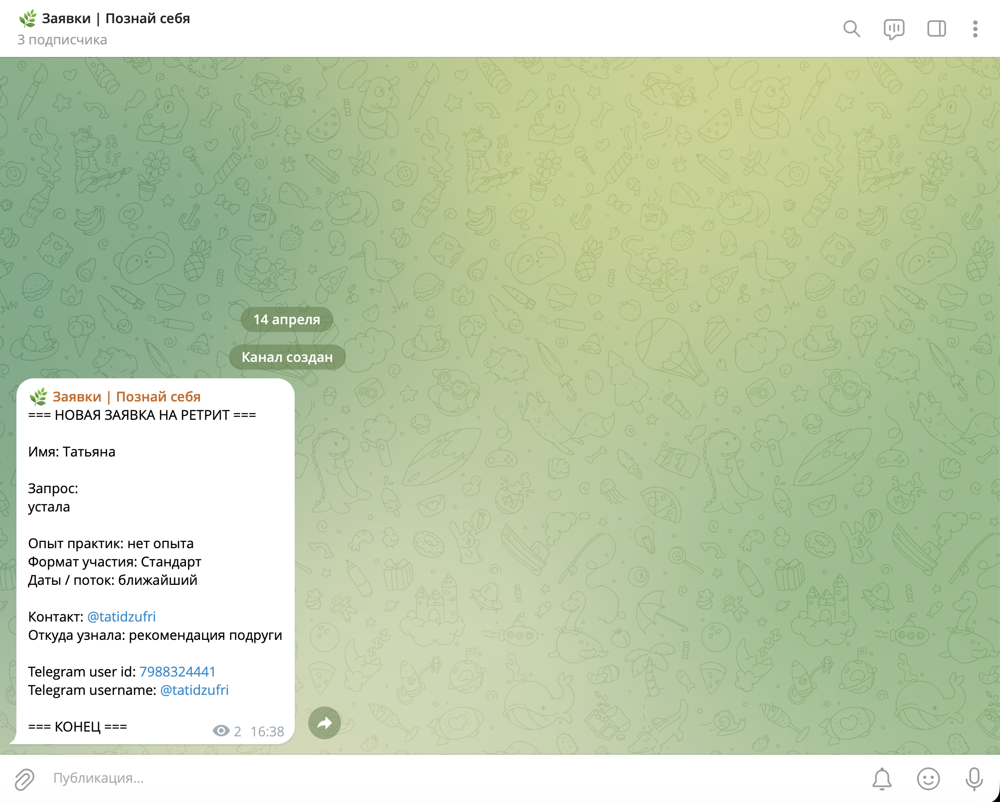

# Telegram-бот для записи на ретрит «Познай себя»

## О проекте

Telegram-бот с AI-ассистентом **Лея**, который в формате живого диалога помогает потенциальной участнице записаться на женский ретрит. Бот заменяет первичный контакт менеджера: мягко знакомится, выясняет запрос и ожидания, собирает контактные данные и передаёт готовую заявку куратору ретрита.

## Задача

Автоматизировать приём заявок на ретрит через Telegram. Целевая аудитория — женщины 30–40 лет, для которых важна тёплая и безопасная атмосфера общения. Бот должен вести диалог не как форма с полями, а как живой разговор: с эмпатией, без давления и в тоне бренда.

## Решение

Бот ведёт свободный диалог, управляемый языковой моделью OpenAI. Модель сама решает, какой вопрос задать следующим, понимает ответы в произвольной форме и извлекает из них нужные данные. Если OpenAI API недоступен, бот переключается на встроенные правила и продолжает работать без потери функциональности.

## Как это работает

1. Участница нажимает «Старт» — бот приветствует от лица Леи и спрашивает имя.
2. В свободном диалоге бот последовательно собирает информацию для заявки:
   - **Имя** участницы
   - **Запрос** — что привело к ретриту, что сейчас происходит в жизни
   - **Опыт практик** — медитации, йога, телесные практики
   - **Формат участия** — Базовый (25 000 ₽), Стандарт (50 000 ₽) или VIP (75 000 ₽)
   - **Даты** — какой заезд интересует
   - **Контакт** для связи куратора
   - **Откуда узнала** о ретрите
3. Когда все данные собраны — заявка автоматически отправляется в закрытый Telegram-канал куратора.
4. Участница получает финальное сообщение: куратор напишет в течение 24 часов.

## Результат

Куратор получает в свой Telegram-канал структурированную заявку со всеми данными участницы — имя, запрос, выбранный тариф, даты, контакт. Дальше он связывается с участницей для персонального сопровождения.

## Демонстрация работы

| Начало диалога | Завершение диалога | Заявка у куратора |
|:-:|:-:|:-:|
|  |  |  |

## Стек технологий

| Технология | Для чего используется |
|---|---|
| **Python 3.12** | Основной язык проекта |
| **aiogram 3** | Фреймворк для работы с Telegram Bot API — обработка сообщений, команд, отправка ответов |
| **OpenAI API** | Языковая модель (gpt-4.1-mini) ведёт диалог, извлекает данные из ответов участницы и формирует ответы в тоне бренда |
| **httpx** | HTTP-клиент для запросов к OpenAI API с поддержкой повторных попыток при сбоях |
| **Pydantic** | Валидация и структурирование данных — модели заявки, сессии, ответа ассистента |
| **pydantic-settings** | Загрузка настроек из переменных окружения и `.env` файла |
| **Docker** | Контейнеризация для простого развёртывания на сервере |
