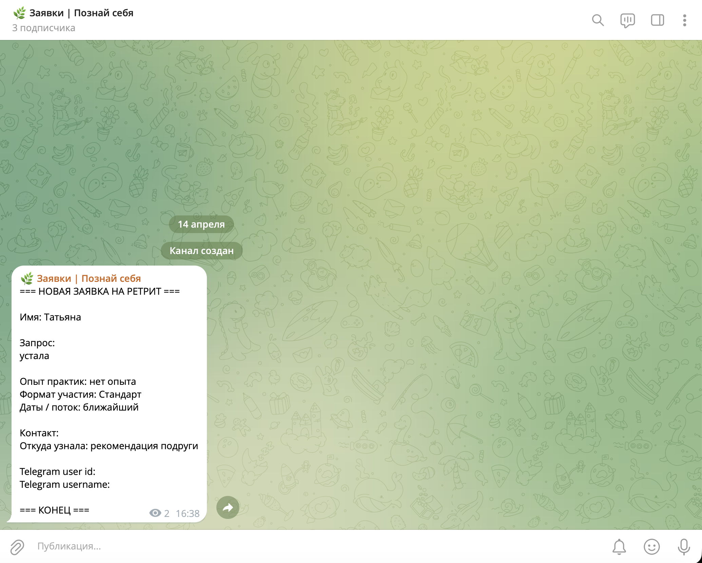
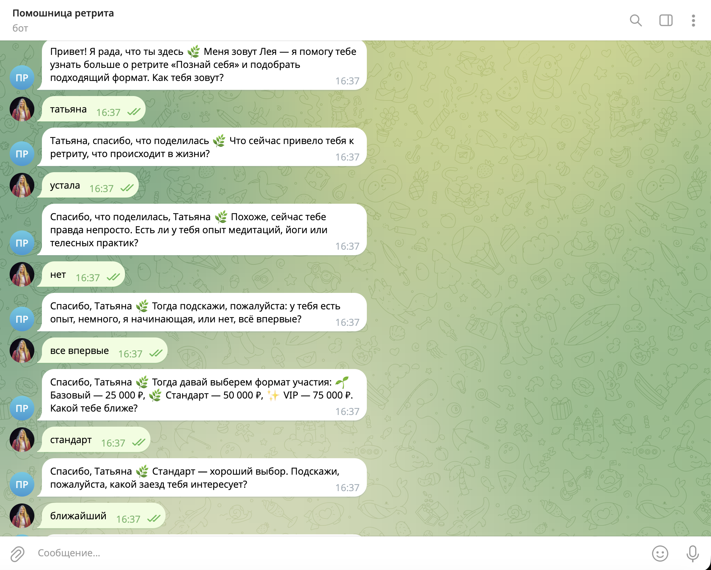

# Leya: an AI lead qualifier for a retreat

A Telegram bot where Leya, an AI assistant, helps a prospective guest sign up for a women's retreat through a natural conversation. The bot takes over a manager's first contact: it gets acquainted, finds out what the person is looking for, collects contact details and hands the curator a finished lead card.

This is a practice project. The retreat, "Know Yourself" («Познай себя»), is a training scenario of a retreat center, not a real organization. The bot speaks Russian and English. Case study: [tatidzufri.com/en/case/lead-qualifier](https://tatidzufri.com/en/case/lead-qualifier).



## About the project

Leya holds a free conversation instead of a form with fields. The language model decides which question to ask next, understands answers in any shape and pulls out the data it needs. When everything is collected, the lead goes to the curator's private Telegram chat, and the guest is told someone will contact her within 24 hours.

## The task

A long sign-up form loses people: they get tired halfway through and don't feel anyone is listening. A manager asking the same first questions by hand is slow and doesn't scale.

The retreat's audience is women aged 30 to 40 who care about a warm, safe atmosphere. The bot had to talk with empathy, without pressure and in the brand's tone, and still bring the person to a complete lead.

## How it works

1. **A conversation, not a form.** Leya finds out, one at a time, the guest's name, what brought her to the retreat, her experience with practices (meditation, yoga, body work), the format she wants, preferred dates, a contact and how she heard about the retreat.
2. **Three formats.** In Russian: Basic 25,000 ₽, Standard 50,000 ₽, VIP 75,000 ₽. In English the scenario is adapted: Basic $390, Standard $1,490 with five days in the Dolomites, VIP $2,290. The model helps choose and records the choice in the lead.
3. **A structured lead.** Model answers are validated with a Pydantic schema. The lead is sent only when every field is filled and the guest is ready.
4. **Resilient to outages.** A request to OpenAI is retried up to three times on transient errors. If the API still doesn't answer, the bot switches to built-in rules and keeps the conversation going.
5. **No database of its own.** Sessions live in the bot's memory and leads go to the curator as messages. The container needs no open ports; the bot polls Telegram itself.
6. **Two languages.** The language comes from `/start en` or `/start ru`, the `/language`, `/en` and `/ru` commands, the Telegram interface language, or the script of the guest's messages.

## What it looks like

| Start of the conversation | End of the conversation | Lead card for the curator |
|:-:|:-:|:-:|
|  |  |  |

The guest presses "Start", Leya says hello and asks her name. From there the conversation goes at the guest's pace. At the end the curator gets a card with the name, the request, the chosen format, dates and contact.

## Results

- The bot runs the first qualification round without a person: the curator receives a ready card with the whole background.
- A guest gets an immediate, warm reply at any time of day.
- If OpenAI is unavailable, sign-up still continues on the built-in rules.

## Tech stack

| Technology | What it's for |
|---|---|
| **Python 3.12** | Project language |
| **aiogram 3** | Telegram: messages, commands, replies |
| **OpenAI API** | Runs the conversation in the brand's tone and extracts data from answers. The model is set in `.env`, `gpt-4.1-mini` by default |
| **httpx** | Requests to OpenAI with retries on transient failures |
| **Pydantic** | Schemas for the lead, the session and the assistant's answer |
| **pydantic-settings** | Settings from `.env` |
| **Docker Compose** | Runs the bot on the server with one command |

## Repository structure

- `bot/`: Telegram handlers and message formatting.
- `services/assistant/`: OpenAI requests, Leya's prompt and the fallback rules.
- `services/workflow.py`: conversation steps and sending the lead.
- `services/telegram/operator_notifier.py`: the lead card for the curator.
- `services/storage/`: in-memory sessions.
- `core/`: settings, logging, data schemas, languages.
- `demo/`: screenshots.

## Running it

You need Docker and Docker Compose.

```bash
cp .env.example .env
docker compose up -d --build
```

In `.env`, fill in `TELEGRAM_BOT_TOKEN`, `OPERATOR_CHAT_ID` (the curator's chat that receives leads) and `OPENAI_API_KEY`.

Without Docker:

```bash
pip install -r requirements.txt
python main.py
```

## Author

Tetiana Dziubas, AI automation engineer. I build Telegram bots, RAG assistants and LLM agents that take routine work off small teams. Case studies and contact: [tatidzufri.com/en](https://tatidzufri.com/en/).
